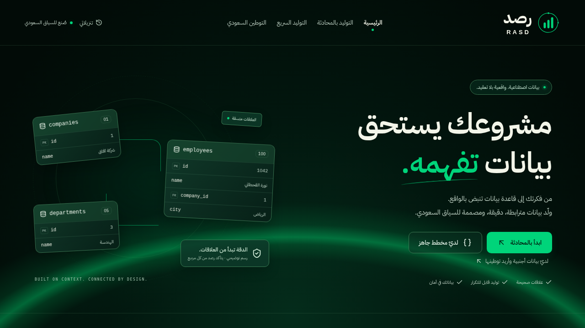

# RASD | AI-Powered Data Platform

Developed for the **Tuwaiq and Replit Hackathon**.

**Live Demo:** Coming soon.

**RASD generates realistic, connected synthetic datasets and localizes foreign datasets for the Saudi context.** It helps developers and researchers prepare useful data for building, testing, and demonstrating their projects through a simple Arabic-first interface.

## Features

- **AI Chat:** Describe your requirements, review a dataset plan, and approve generation through a natural conversation.
- **Quick Generate:** Upload a supported database schema or project ZIP and generate compatible synthetic records automatically.
- **Saudi Localization:** Upload existing data and adapt supported names, locations, contact details, and economic values to the Saudi context while preserving identifiers and relationships.

RASD validates records, relationships, and supported financial calculations before export. Relevant Saudi research informs supported transformations, with estimates clearly distinguished from source-backed values.

## Built With

TypeScript · React · Vite · Node.js · Fastify · OpenRouter · Tavily

[Setup and development](docs/DEVELOPMENT.md)
